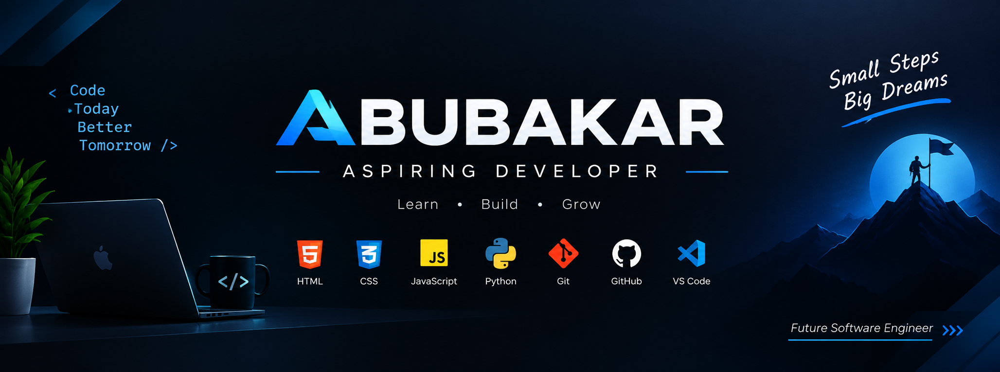

# ABUBAKAR
### `Aspiring Software Developer | Building for the Future`

  

---

## `01` — Introduction

Hello! I'm **Abubakar**, an aspiring software developer with a strong interest in technology, programming, and digital innovation.

I enjoy exploring how things work, developing new skills, and transforming creative ideas into functional digital experiences.

My focus is on building a strong foundation in software development while continuously improving through practical projects and hands-on learning.

## `02` — Technical Arsenal

**Programming & Development**

  

**Development Tools**

  

## `03` — What I'm Working On

- Developing modern and responsive web interfaces.
- Strengthening JavaScript and Python fundamentals.
- Exploring software development concepts.
- Building practical projects to improve my skills.
- Learning efficient development workflows.

## `04` — GitHub Insights

  
  

## `05` — My Philosophy

> "Great software is built through curiosity, consistency, and the courage to keep learning."

## `06` — Find Me Online

  

---

  <b>DESIGN. DEVELOP. LEARN. EVOLVE.</b>
   
  Thanks for visiting my digital workspace.

